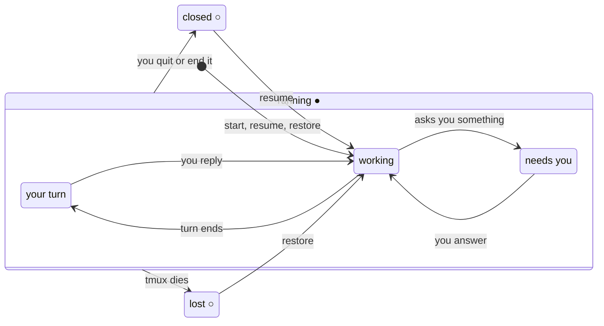
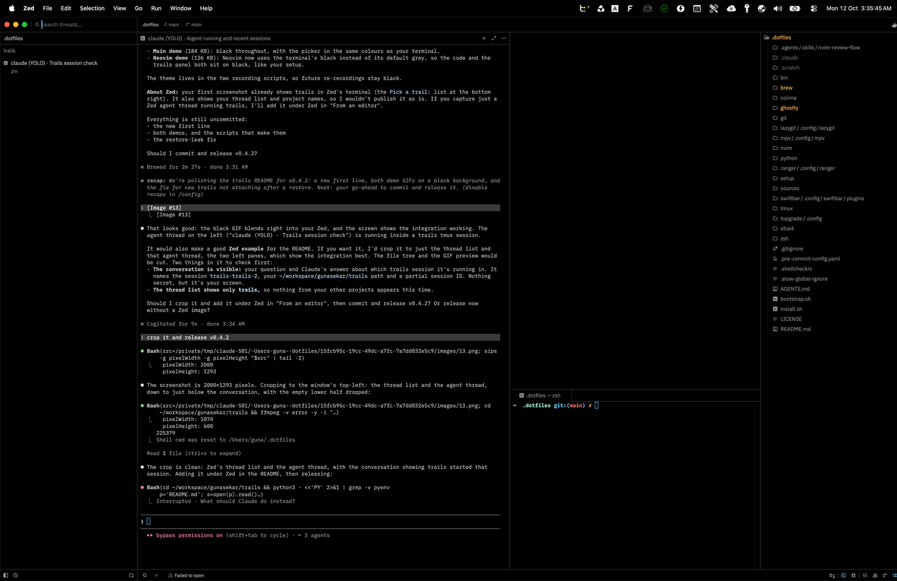

<h1>
  <picture>
    <source media="(prefers-color-scheme: dark)" srcset="assets/logo-dark.png">
    
  </picture>
</h1>

**Never lose an AI coding agent again. Claude Code, Codex and the rest run in tmux, and drop into any terminal or editor.**


trails starts Claude Code, Codex, Gemini, Copilot, Cursor, opencode or any other
agent CLI in a tmux session of its own, then helps you find it again, resume it,
or end it. That's all it does. There's no TUI or GUI of its own: the sessions are
tmux, and once an agent is running trails gets out of the way.

Because it's just a command, it plugs into whatever you already use:

- **any editor with a terminal**: VS Code, Zed's agent threads, a Neovim side
  panel, or anything else that can run a command in a pane
- **any terminal** (Ghostty, iTerm, Terminal), in the project you're working on
- **the macOS menu bar**, which shows the agents waiting on you

Every one of them lands on the same sessions: start an agent in VS Code, check on
it from a terminal, pick it up in Neovim. And `trails map` puts several in one
window, a tmux session of tmux sessions, so you can watch them all and answer
whichever one stops.

```console
~/code/checkout $ trails
Pick a trail: █   # enter: open · tab: toggle YOLO · ctrl-x: end or forget
▌ ● needs you  claude · yolo  Add idempotency keys to payment retries
  ● your turn  claude    #2   Fix the flaky cart-total test
  ● working    codex          Migrate orders to Postgres 17
  ○ lost       claude         Spike: replay Stripe webhooks
  claude · new trail
  codex · new trail
  cursor · new trail
  ↩ resume old trails  (3 ended)
```

Enter on **↩ resume old trails** opens the conversations that ended here, and Esc
comes back:

```console
Resume a trail: █   # enter: resume · tab: toggle YOLO · esc: back
▌ ○ closed     claude · yolo  2d ago  Release notes for v2.3
  ○ closed     claude         4d ago  Tighten the refund window
  ○ closed     codex          6d ago  Bump the payment SDK
```

`trails` shows the sessions for the directory you're in, running (`●`) and lost
(`○`) ones, then the agents you can start, then a way into the ones that ended.
*needs you* is asking you something, *your turn* finished its turn, and *lost* is
a session tmux took down. Every row does something on Enter; type to filter.
`trails ls` shows every directory:

```console
~ $ trails ls
● needs you  claude · yolo  ~/code/checkout              Add idempotency keys to payment retries
● your turn  claude         ~/code/checkout #2           Fix the flaky cart-total test
● working    codex          ~/code/checkout              Migrate orders to Postgres 17
● working    claude         ~/code/storefront            Lazy-load product images
○ lost       claude         ~/code/checkout              Spike: replay Stripe webhooks
○ closed     claude · yolo  ~/code/checkout      2d ago  Release notes for v2.3
```

Because each agent runs inside tmux, it outlives the terminal that started it.
Close the laptop, drop Wi-Fi or quit the terminal, and the conversation is still
running when you come back. A plain shell, a Zed thread and an nvim panel all go
through `trails` and land on the same sessions.

## Install

With Homebrew, on macOS or Linux:

```console
brew install gunasekar/tap/trails
```

By hand: it's one POSIX `sh` script. Put [`bin/trails`](bin/trails) anywhere on
your `PATH`.

It needs `tmux`, `fzf` and `jq`, plus at least one agent CLI on `PATH`. macOS
ships `jq`; Homebrew installs all three. Reading recent opencode conversations uses
`sqlite3`, which macOS ships with.

## Quickstart

```console
cd ~/code/my-project
trails              # pick an agent to start, or a session to rejoin or resume
trails ls           # where every session is, in every directory
trails map 4        # the four that most want you, side by side in one window
```

## Usage

| Command | Does |
|---|---|
| `trails` | the picker for this directory: start an agent, or rejoin, restore or resume a session |
| `trails ls` | where every agent session is: running, lost when tmux died, or finished in the last 10 days |
| `trails restore` | bring back every session lost when tmux died, each on its own conversation, detached |
| `trails map [N]` | several running agents side by side in one window: re-attach to the map already up, pick a set, or take the `N` that most want you (`map new` forces a fresh pick) |
| `trails swiftbar` | put the menu-bar plugin into SwiftBar (macOS); `--remove` takes it out |
| `trails config` | open the agents file in `$EDITOR`, writing the built-ins first if there isn't one |
| `trails help` | the commands and picker keys (also `-h`, `--help`) |

### The picker

`trails` shows this directory's running and lost sessions first, then one
*new trail* row per agent, then **↩ resume old trails**, which opens a second
list of the conversations that ended here (Esc goes back). The cursor starts on
the session that most wants you.

Every session has two signals. The glyph says whether its tmux session is
running (`●`) or not (`○`); the word says what's going on:

| State | Means | Enter |
|---|---|---|
| `●` needs you | running, and the agent is asking you something | attach |
| `●` your turn | running, and it finished its turn | attach |
| `●` working | running, and it's busy | attach |
| `○` lost | tmux died under it (a reboot, a crash, `kill-server`) | bring it back on its conversation |
| `○` closed | it ended in the last 10 days; its conversation can be resumed | resume it, in the mode it last ran in |
| `○` elsewhere | its conversation is open in a `claude` that trails didn't start | refuses, and says where it's open |



| Key | Does |
|---|---|
| `enter` | open the row: attach, restore, resume, or start the agent |
| `tab` | toggle YOLO (run everything unconfirmed) on an agent to start or a closed session, flipping it from the config's `mode` |
| `ctrl-x` | end a running session, or forget a lost one |

`trails` refuses to open an agent in `/`. `$HOME` is fine.

### trails ls

```console
$ trails ls
● needs you  claude · yolo  ~/code/api                Rework the retry budget
● your turn  claude         ~/.dotfiles #2            Fix the flaky test
○ lost       claude · yolo  ~/code/foundry            Improve observability
○ closed     claude · yolo  ~/notes         2h ago    Weekly review
○ elsewhere  claude         ~/scratch       1d ago    Spike on caching  (open in claude, pid 812)

● needs you  running, asking you something
● your turn  running, finished its turn
○ lost       not running: tmux died · trails restore brings it back
○ closed     not running: it ended · resume it from its directory
○ elsewhere  not running here: open in a claude trails did not start
```

`#2` marks the second session in the same directory, and the dim legend covers
the states on screen. Piped, `ls` prints one tab-separated line per row, in the
same order, with `-` for an empty field:

```text
life  state  session  agent  yolo  dir  id  when  pid  title
```

| Field | Values |
|---|---|
| `life` | `running` (the tmux session is there) or `stopped` |
| `state` | `needs-you`, `your-turn`, `working` (running) · `lost`, `closed`, `elsewhere` (stopped) |
| `session` | the tmux session name, or `-` for a conversation nothing is running |
| `yolo` | `yolo` or `-` |
| `when` | when an ended conversation was last active (Unix time), else `-` |
| `pid` | the process holding an `elsewhere` one, else `-` |

That is what the menu-bar plugin below reads, and anything else can too. Set
`TRAILS_RECENT_MAX=0` for a poll that only wants running sessions; it skips
reading conversation history.

### trails map

`trails map 4` puts the four sessions that most want you side by side in one
window, across projects. Each pane is a live view of a real session, labelled with
its directory, its agent and what it's working on; type into any of them, and
detach (`C-b d`) to leave them all running. `trails map` re-attaches to the map
already up, or lets you pick a set.

### Menu bar (macOS)

trails ships a [SwiftBar](https://swiftbar.app) plugin that keeps your agents in
the menu bar, whether or not you're looking at them:

```console
brew install --cask swiftbar    # once, then open it and pick a plugin folder
trails swiftbar                 # link the plugin in; --remove takes it out
```

- **The icon is the trails mark.** Its top dot turns red when an agent is asking
  you something and amber when one finished its turn; its bottom dot is green
  while any agent is working. The number beside it is how many want you.
- **The menu** lists every running session. Each has *Resume*, which opens it in
  a new tab of your terminal, and, once it's your turn, *End session*.
- **Open sessions in** at the bottom picks the terminal: Terminal (the default),
  iTerm or Ghostty.
- **Notifications:** an agent that stops working and stays stopped for 30 seconds
  sends one notification. `TRAILS_NOTIFY_AFTER` changes the wait; `0` notifies at
  once.
- It hides itself when no agent is running.

The plugin is linked, not copied, so `brew upgrade trails` updates it along with
the `trails ls` it reads.

### Environment

| Variable | Default | Does |
|---|---|---|
| `TRAILS_RECENT_DAYS` | `10` | how far back closed sessions are listed |
| `TRAILS_RECENT_MAX` | `5` | how many of them to show (`0` for none) |
| `AGENT_SETTLE` | `0.35` | seconds between the two screen samples that tell *working* from *your turn* |
| `AGENT_ASK_RE` | *(see script)* | regex meaning "this agent is asking you something" |

### Agents

Which agents trails can start, and how, is a list in
`~/.config/trails/config.json`. With no file, the built-in agents apply.
`trails config` writes them out as a starting point and opens the file in
`$EDITOR`. Changing agents never needs a change to trails.

```json
{
  "mode": "default",
  "default_agent": "claude",
  "agents": [
    {
      "name": "claude",
      "program": "claude",
      "yolo": "--dangerously-skip-permissions",
      "session": { "start": "--session-id {id}", "resume": "--resume {id}", "id": "uuid" }
    },
    { "name": "claude-opus", "program": "claude --model opus", "yolo": "--dangerously-skip-permissions" },
    { "name": "aider", "program": "aider --model ollama_chat/gemma3:1b", "yolo": "--yes-always" }
  ]
}
```

| Field | Means |
|---|---|
| `name` | what the picker shows. Letters, digits, `.`, `_` and `-` |
| `program` | the command line to run, split on spaces (no shell quoting; use a wrapper script for anything fancier) |
| `yolo` | *(optional)* the flag Tab adds to run everything unconfirmed |
| `session` | *(optional)* how trails learns which conversation a session is in, so it can come back after tmux dies. See below. |
| `default_agent` | *(optional)* listed first in the picker |
| `mode` | *(optional)* `default` (the agent's own, prompting mode) or `yolo`: the mode a *new trail* row starts in. Tab flips a row from it, so with `yolo` Tab is how you start one in default mode. Closed sessions come back in the mode they last ran in, and an agent with no `yolo` flag always runs in default mode. |

Only agents whose command is on `PATH` are offered. Recent conversations are
read from claude's and opencode's own history, and are filed under the first
agent that runs `claude` or `opencode`.

#### Restore

To bring a session back after tmux dies, trails needs the ID of the conversation
it was in. `session.resume` says how to resume one (`{id}` marks where the ID
goes), plus one of three ways to learn the ID:

| Key | trails gets the ID by | Example |
|---|---|---|
| `start` | choosing it, and starting the agent under it | `"start": "--session-id {id}", "id": "uuid"` |
| `create` | running a command that prints a fresh one | `"create": "cursor-agent create-chat"` |
| `find` | reading it back from the agent's own files (`claude`, `codex`) | `"find": "codex"` |

`id` is the shape `start` generates: `uuid`, or `ses_hex` for opencode. `find`
also follows a conversation that changes inside the agent, such as `/resume` in
claude.

#### Built-in agents

The six most-used coding agents, with flags checked against each tool's latest
`--help` or docs in October 2026:

| Agent | Runs | YOLO flag | Restore |
|---|---|---|---|
| claude | `claude` | `--dangerously-skip-permissions` | yes: chosen ID, and follows `/resume` |
| codex | `codex` | `--dangerously-bypass-approvals-and-sandbox` | yes: read from `~/.codex/sessions`, once its first message is sent |
| gemini | `gemini` | `--approval-mode yolo` | yes: chosen ID |
| copilot | `copilot` | `--allow-all` | yes: chosen ID |
| cursor | `cursor-agent` | `--force` | yes: `cursor-agent create-chat` |
| opencode | `opencode` | `--auto` | yes: chosen ID |

A session that never got a message has nothing to resume, so restoring one
starts the agent fresh in its place.

Any other agent is one entry in the config. It runs in tmux like the rest; add a
`session` block only if the tool can start or resume by ID:

```json
{ "name": "aider", "program": "aider --model ollama_chat/gemma3:1b", "yolo": "--yes-always" },
{ "name": "antigravity", "program": "agy", "yolo": "--dangerously-skip-permissions" },
{ "name": "qwen", "program": "qwen", "yolo": "--yolo" }
```

trails refuses a YOLO launch as root for the two flags that also bypass a sandbox
(`--dangerously-skip-permissions`, `--dangerously-bypass-approvals-and-sandbox`).

### From an editor

Any editor that can run a command in a terminal pane can run `trails`, and every
editor and every shell shares one set of sessions.

- **VS Code:** add a terminal profile, then pick **trails** from the new-terminal
  menu. A login shell, so `trails` is found on your usual `PATH`:

  ```json
  "terminal.integrated.profiles.osx": {
    "trails": { "path": "/bin/zsh", "args": ["-lc", "exec trails"] }
  }
  ```

  To open it as an editor tab with a key, add to `keybindings.json`:

  ```json
  {
    "key": "cmd+alt+t",
    "command": "workbench.action.terminal.newWithProfile",
    "args": { "profileName": "trails", "location": "editor" }
  }
  ```

  The same works in Cursor and other VS Code-based editors.

- **Zed:** in `settings.json`, set `"terminal_init_command": "exec trails"` under
  `agent`. In remote mode it runs on the ssh host, where tmux keeps the agent
  alive across disconnects.

  
- **Neovim:** open a terminal running `trails` in a side panel, like the second
  demo at the top.
- **Anything else:** run `trails` wherever the editor opens a terminal.

## How it works

[docs/ARCHITECTURE.md](docs/ARCHITECTURE.md) covers how sessions are named and
found, how *working*, *your turn* and *needs you* are read off the screen, how sessions
survive tmux dying, where recent conversations come from, and how the map
borrows sessions without owning them. Key design decisions are recorded in
[docs/decisions/](docs/decisions/).

## License

[MIT](LICENSE)
