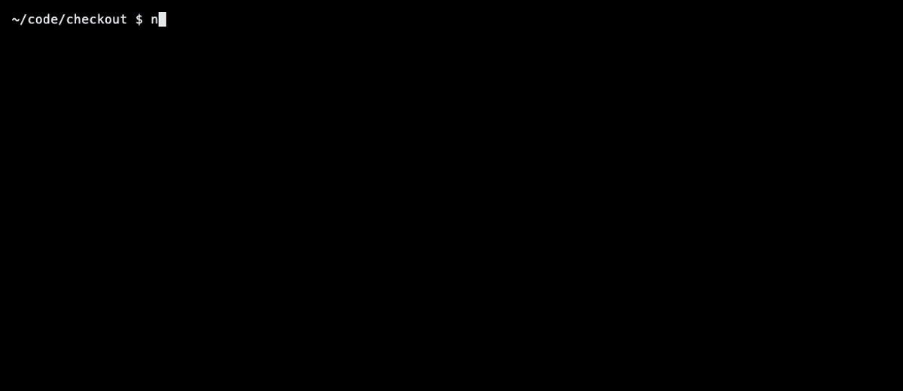
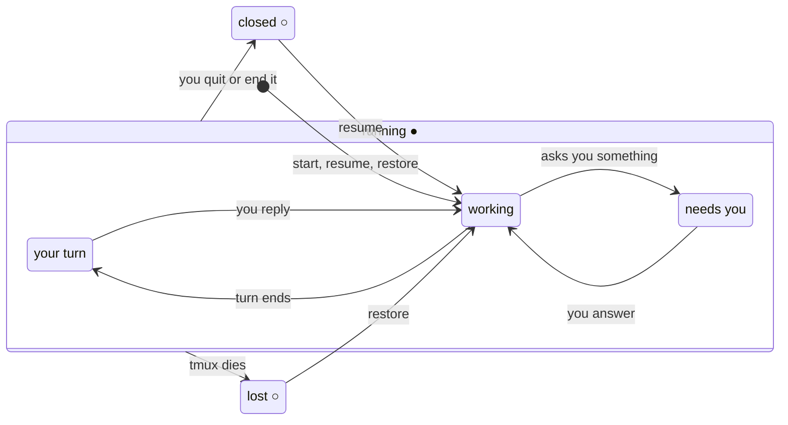

<h1>
  <picture>
    <source media="(prefers-color-scheme: dark)" srcset="assets/logo-dark.png">
    
  </picture>
</h1>

**Your coding agents, in tmux, by workspace. Reachable from any editor, any
terminal, and over one ssh connection.**

trails is a command-line tool: a session manager for coding agents, built on
tmux. It runs Claude Code, Codex, Gemini, Copilot, Cursor, opencode or any other
agent CLI in a tmux session of its own, a *trail*, and groups trails by
workspace, a set of codebases you choose. From anywhere, `trails` shows what is
running and what is waiting on you, opens the one you pick, brings old ones back
after tmux or the machine dies, and puts the editor beside the agent with one key.





## What it's for

- **One machine holds the agents.** A laptop, a desktop or a server runs tmux and
  the agents; everything else, including a second laptop, is a thin client over
  ssh. Close the lid, drop Wi-Fi, come back: the conversation is where you left
  it, mid-turn.
- **Work grouped the way you think of it.** A workspace is a company, a client,
  or "personal": unrelated repos together. One ssh connection carries every
  workspace, and `trails ws` moves between them without reconnecting.
- **The agent first, the editor beside it.** Start the agent, and bring up
  nvim and a shell next to it when you want them, in the same tmux session.
- **Every editor sees the same trails.** Zed over ssh, VS Code Remote, a Neovim
  panel and a plain terminal all land on the same running agents. An editor's
  panel sees exactly one trail; your terminal sees the workspace.
- **Nothing but tmux.** No TUI or daemon of its own, no key bindings, no tmux
  options beyond its own `@trails_*` marks. `tmux ls` reads as your layout, plain
  tmux keys drive it, and uninstalling trails leaves ordinary tmux behind.

## Works with

| | |
|---|---|
| Agents | Claude Code, Codex, Gemini, Copilot, Cursor, opencode built in; any CLI by one config entry. Claude and Codex report their own state and conversation; the rest are read off the screen |
| Editors | Zed (local and over ssh), VS Code and Cursor (local and Remote-SSH), Neovim, anything with a terminal pane |
| Terminals | any, including over ssh; a popup inside tmux with `trails keys` |
| Systems | macOS and Linux; tmux 3.3 or later, fzf, jq. The menu-bar plugin is macOS, through SwiftBar |
| From 0.6 | running `trails-<project>` sessions keep working until they end, and restore into the new model |

Because it's just a command, it plugs into whatever you already use:

- **any editor with a terminal**: VS Code, Zed's agent threads, a Neovim side
  panel, or anything else that can run a command in a pane
- **any terminal** (Ghostty, iTerm, Terminal), in the project you're working on
  or over ssh to the machine where the agents live
- **the macOS menu bar**, which shows the agents waiting on you

Every one of them lands on the same trails.

```console
~/code/checkout $ trails
checkout (acme) ▸ Pick a trail: █   # enter: open · ctrl-e: editor · ctrl-/: preview · ctrl-x: end or forget · esc: up
  ＋ new trail…
▌ ● needs you  claude · yolo  Add idempotency keys to payment retries
  ● your turn  claude    #2   Fix the flaky cart-total test
  ● working    codex          Migrate orders to Postgres 17
  ○ lost       claude         Spike: replay Stripe webhooks
  ↩ resume old trails  (3 ended)
```

Enter on **＋ new trail…** lists the agents to start here, with Tab for YOLO and
ctrl-n to name the trail:

```console
checkout (acme) ▸ Start an agent: █   # enter: start · tab: toggle YOLO · ctrl-n: name it · ctrl-e: editor · esc: back
▌ claude · new trail
  codex · new trail
  cursor · new trail
```

Enter on **↩ resume old trails** opens the conversations that ended here, and Esc
comes back:

```console
Resume a trail: █   # enter: resume · tab: toggle YOLO · ctrl-e: editor · ctrl-/: preview · esc: back
▌ ○ closed     claude · yolo  2d ago  Release notes for v2.3
  ○ closed     claude         4d ago  Tighten the refund window
  ○ closed     codex          6d ago  Bump the payment SDK
```

From `~`, or a fresh ssh login, `trails` lists your workspaces instead, with what
runs in each; from a shell in a workspace's tmux session it lists that workspace's
trails across its codebases. `trails ls -a` shows every directory:

```console
~ $ trails ls -a
@checkout-3         ● needs you  claude · yolo  acme      ~/code/checkout              Add idempotency keys to payment retries
#2 @checkout-7      ● your turn  claude         acme      ~/code/checkout              Fix the flaky cart-total test
                    ● working    codex          acme      ~/code/checkout              Migrate orders to Postgres 17
@storefront-2       ● working    claude         personal  ~/code/storefront            Lazy-load product images
                    ○ lost       claude         acme      ~/code/checkout              Spike: replay Stripe webhooks
                    ○ closed     claude · yolo  acme      ~/code/checkout      2d ago  Release notes for v2.3
```

Because each agent runs inside tmux, it outlives the terminal that started it.
Close the laptop, drop Wi-Fi or quit the terminal, and the conversation is still
running when you come back. ssh in from another machine and run `trails`, and
you're in the very same coding sessions: the same conversations, mid-turn, right
where you left them. One ssh connection reaches every workspace, and you move
between them without reconnecting.

And if tmux itself goes down, after a reboot, a crash or a `kill-server`, the
trails show up as *lost*, not gone. `trails restore` brings each one back on the
conversation it was in, into its workspace.

## Install

With Homebrew, on macOS or Linux:

```console
brew install gunasekar/tap/trails
```

By hand: it's one POSIX `sh` script. Put [`bin/trails`](bin/trails) anywhere on
your `PATH`.

It needs `tmux` (3.3 or later), `fzf` and `jq`, plus at least one agent CLI on
`PATH`. macOS ships `jq`; Homebrew installs all three. Reading recent opencode
conversations uses `sqlite3`, which macOS ships with.

## Quickstart

```console
trails ws add acme ~/code/checkout   # file a codebase under a workspace (optional)
cd ~/code/checkout
trails              # pick an agent to start, or a trail to rejoin or resume
trails edit         # the editor beside it, in the same tmux session
trails ls -a        # where every trail is, in every directory
trails map 4        # the four that most want you, side by side in one window
trails keys         # tmux.conf lines that put all of this on a key
```

With no workspaces configured, everything runs in one workspace called
`default`, and trails behaves much as it did before 1.0.

## Usage

| Command | Does |
|---|---|
| `trails` | the picker for where you are: this codebase's trails and the agents you can start; a workspace's trails, from a shell in its tmux session; or the workspaces, from `~` |
| `trails ws [NAME]` | pick a workspace, or go to `NAME`: switch to its session inside tmux, attach outside, landing on the trail that most wants you; its picker when nothing runs there |
| `trails ws list` / `ws of [DIR]` / `ws add NAME [DIR]` | the workspaces in the config; the one `DIR` (here) belongs to; put `DIR` (here) in workspace `NAME`, creating it if new |
| `trails new NAME [AGENT]` | start a trail named `NAME`, with `-y` for YOLO: its session is `<workspace>/NAME`, and claude takes `NAME` as its own name, so other Claude sessions can message it by that name |
| `trails edit` / `shell` | the editor beside the agent, or a shell along the bottom, as panes of the trail's window in the workspace (the editor alone in a window of its own when nothing runs there): made once, then selected. The window you are on says which codebase, or `DIR` after the command |
| `trails ls [-a \| DIR]` | this directory's trails: running, lost when tmux died, or finished in the last 10 days. `DIR` lists that directory instead, `-a` every directory |
| `trails open KEY` | go to a trail from anywhere, by the key `trails ls` prints (`acme/checkout-2`): its workspace on its window, or the trail alone from an editor's terminal |
| `trails end KEY` | end a trail from anywhere, by the key `trails ls` prints (`acme/checkout-2`) |
| `trails restore` | bring back every trail lost when tmux died, each on its own conversation, into its workspace, detached |
| `trails map [N]` | several running agents side by side in one window: re-attach to the map already up, pick a set, or take the `N` that most want you (`map new` forces a fresh pick) |
| `trails keys` | print tmux.conf lines that put the picker in a popup and bind the editor and the shell; trails binds nothing itself |
| `trails swiftbar` | put the menu-bar plugin into SwiftBar (macOS); `--remove` takes it out |
| `trails config` | open the config in `$EDITOR`, writing the built-ins first if there isn't one |
| `trails help` | the commands and picker keys (also `-h`, `--help`) |

### Workspaces

A workspace is a set of codebases you choose, related or not: one per company,
say, or everything personal. It is declared in `~/.config/trails/config.json`,
as paths or globs, with an optional `root`:

```json
"workspaces": {
  "acme":     { "root": "~/code", "codebases": ["~/code/*"] },
  "personal": ["~/src/*", "~/.dotfiles"]
}
```

- An entry ending in `/*` is a *workspace directory*: every folder in it is a
  codebase, so a newly cloned repo needs no edit. Any other entry is a codebase
  of its own, and a path that is also a workspace directory makes that
  directory a codebase too.
- A folder inside a listed one belongs to it, at any depth, and a git worktree
  belongs where its main checkout does, wherever it lives.
- The most specific entry wins an overlap: an exact path beats a glob.
- `root` is where `browse…`, under "＋ new trail…" in the picker, starts walking;
  `~` without one.
- A name is letters, digits, `-` and `_`: it becomes a tmux session name.
- `trails ws add NAME` adds a codebase for you, and the picker offers to when
  you start a trail in a directory no workspace claims. Edits never move a running
  trail.

### What tmux shows

Each trail is a small tmux session of its own, holding the agent and nothing
else: what an editor attaches to, with nothing it can wander off to. A workspace
is a tmux session named after it, with a window per trail whose first pane is a
nested tmux client showing the trail's session, the way a pane of the map does.
The editor and a shell you open beside the agent are panes of that window, so the
trail's session, and any editor on it, never sees them.

```text
acme                    ← workspace
├─ checkout·claude      ← shows acme/checkout; nvim and a shell beside it (trails edit, shell)
├─ checkout·claude-2    ← shows acme/checkout-2
├─ ledger·codex         ← shows acme/ledger
└─ billing·nvim         ← the editor alone, nothing running in billing
acme/checkout           ← a trail: claude in ~/code/checkout
acme/checkout-2         ← another, same codebase
acme/ledger             ← codex in ~/code/ledger
```

The pane showing a trail runs a tmux client, so a `pane-border-format` that
labels panes by their command reads `tmux` on it; the pane carries `@ag` (the
agent) and `@dir` (the codebase) for that, as the map's panes do:
`#{?@ag,#{@ag},#{pane_current_command}}`.

Plain tmux moves you around: the next and previous window keys, `prefix s` or
`choose-tree`, `switch-client`. `tmux a -t acme` is the workspace and
`tmux a -t acme/checkout` is one trail. trails sets nothing on any of it beyond
`@trails_*` options, never touches your tmux.conf, and binds no keys: `trails keys`
prints lines to paste if you want some. The popups take the terminal's own
background: tmux 3.8 shades them grey by default, which a list in dim text does
not survive. `bg=terminal` is tmux 3.8's word for it; before 3.8 the word is
`bg=default`, and `trails keys` prints the one your tmux takes, so paste again
after upgrading past 3.8.

```text
# trails: paste what you want into tmux.conf
bind P display-popup -E -w 80% -h 70% -s bg=terminal -S bg=terminal,fg=brightblack trails
bind W display-popup -E -w 60% -h 50% -s bg=terminal -S bg=terminal,fg=brightblack 'trails ws'
bind e run-shell "TRAILS_CLIENT=#{client_name} trails edit"
bind ` run-shell "TRAILS_CLIENT=#{client_name} trails shell"
```

The two `run-shell` lines pass the terminal that pressed the key, so with two
terminals on one workspace the right one moves. All four keys are unbound in
tmux's defaults. Change any of them.

A session exists while something runs in it: the first trail creates the
workspace session, and the last one out takes it down. A session named like a
workspace that trails didn't make is refused, never added to.

**A workspace in two terminals.** Every terminal on a tmux session shares its
current window, so a second terminal on `acme` moves when the first does. For a
second terminal that moves on its own, give it a session grouped with the
workspace's: the same trails, and a current window of its own.

```sh
tmux new-session -t acme -s 'acme~2' ; set destroy-unattached on
```

`-t acme` groups it with `acme`, `-s` names it, and `destroy-unattached` takes it
away when that terminal closes. trails treats it as `acme`: the picker shows
acme's trails, and picking one, or opening the editor or a shell, moves that
terminal alone and keeps it on `acme~2`. trails never makes such a session
itself, and the workspaces list counts `acme` once.

### The picker

One picker at four levels: the workspaces, a workspace, a codebase, and the
agents to start. Where it runs decides the level it opens on. Enter goes down a
level, Esc goes up one, and ctrl-c quits
([ADR 17](docs/decisions/0017-one-picker-levels-not-screens.md)).

**This codebase** (a shell in a repo, or an editor's terminal): **＋ new trail…**
first, which lists the agents to start here, then its running and lost trails,
its editor and shell windows (not in an editor's terminal, which wants trails
only), then **↩ resume old trails**, which opens a second list of the conversations that
ended here (Esc goes back). The cursor starts on the trail that most wants you.
Picking a running trail from a terminal of your own lands in the workspace on
that trail's window; from an editor's terminal it attaches to the trail's session,
so the editor sees that one trail.

**This workspace** (a shell in a workspace's tmux session, or a popup over one):
its trails across its codebases, with a codebase column, and one way to start a new one:

```console
acme ▸ Pick a trail: █   # enter: open · ctrl-e: editor · ctrl-/: preview · ctrl-x: end · esc: up
▌ ● needs you  checkout  claude · yolo  Add idempotency keys to payment retries
  ● your turn  ledger    codex          Migrate orders to Postgres 17
  ○ lost       checkout  claude         Spike: replay Stripe webhooks
  editor       checkout  nvim · acme/checkout
  ＋ new trail…  (53 codebases)
  ↩ resume old trails  (12 ended)
```

**＋ new trail…** lists the workspace's codebases as a tree: each workspace
directory with its folders under it, those with trails or recent history first,
then the codebases of their own, then `browse…`. Pick one, then an agent to start
there, with Tab for YOLO and ctrl-n to name it. Esc on either list comes back:

```console
acme ▸ New trail in: █   # enter: pick · esc: back
▌ ~/code/                   browse inside
    checkout                ● 2 trails
    ledger                  ○ 1 ended
    billing
    …
  ~/ops/terraform
  browse…                   from ~/code

ledger (acme) ▸ Start an agent: █   # enter: start · tab: toggle YOLO · ctrl-n: name it · ctrl-e: editor · esc: back
▌ claude · new trail
  codex · new trail
```

`browse…` and a workspace directory that isn't a codebase itself walk the file
system a folder at a time. A folder inside the workspace starts its trail there
with nothing asked, and is listed in the tree while it has trails or history. A
folder outside every workspace gets the question below.

**The workspaces** (from `~`, `/`, or `trails ws`): one row each, with what runs
in it, the one you were in last marked and under the cursor. Enter attaches to
its session on the trail that most wants you, or shows its screen when nothing
runs there. ctrl-n names a new workspace and takes its first codebase from the
directories under `~`.

```console
Pick a workspace: █   # enter: open · ctrl-n: new workspace
▌ acme         ● 3 trails · 1 needs you  · last
  personal     ● 1 trail
  client-x       nothing running
```

Every trail has two signals. The glyph says whether it is running (`●`) or not
(`○`); the word says what's going on:

| State | Means | Enter |
|---|---|---|
| `●` needs you | running, and the agent is asking you something | attach |
| `●` your turn | running, and it finished its turn | attach |
| `●` working | running, and it's busy | attach |
| `○` lost | tmux died under it (a reboot, a crash, `kill-server`) | bring it back on its conversation |
| `○` closed | it ended in the last 10 days; its conversation can be resumed | resume it, in the mode it last ran in |
| `○` elsewhere | its conversation is open in a `claude` that trails didn't start | refuses, and says where it's open |



| Key | Does |
|---|---|
| `enter` | open the row: attach, restore, resume, start the agent, or go to the editor or shell window |
| `tab` | toggle YOLO (run everything unconfirmed) on an agent to start, in the agents list, or a closed trail, flipping a new trail from the config's `mode` and a closed one from the mode it last ran in |
| `ctrl-n` | in the agents list, name the trail you are about to start: type the name, then Enter. On the workspace picker, a new workspace |
| `ctrl-e` | the editor for the row's codebase (`trails edit`) |
| `ctrl-/` | show or hide the preview: the trail's screen as it is now. Open by default when the terminal fits two columns |
| `ctrl-x` | end a running trail, close an editor or shell window, or forget a lost one |
| `esc` | up a level: an old list or the agents back to where they came from, a codebase's screen to its workspace's, a workspace's to the workspaces, and the workspaces out. An editor's terminal quits from its codebase's screen |
| `ctrl-c` | quit, from any screen |

`trails` refuses to open an agent in `/`. `$HOME` is fine. A directory no
workspace claims asks which workspace its trail goes in, each time:

```console
~/Downloads/spike is in no workspace: █
▌ default    not added to a workspace
  personal   add it here
  acme       add it here
```

Enter keeps it in `default`, the workspace for every trail whose directory no
workspace claims. A workspace's row adds the directory to it as a codebase.
`trails new` asks nothing and uses `default`.

### Named trails

Name a trail when you start it, and that one name is how everything refers to it:

```console
~/code/checkout $ trails new payments
~/code/checkout $ trails ls
@payments        ● working    claude · yolo  acme  ~/code/checkout
#2 @checkout-7   ● your turn  claude         acme  ~/code/checkout  Fix the flaky cart-total test
```

- **tmux** has its session as `acme/payments`, so `tmux a -t acme/payments` works,
  and its window in the workspace as `checkout·payments`.
- **The picker and `trails ls`** show `#payments` where an unnamed trail shows `#2`.
- **Claude** runs with `--name payments`, the name its peers use. In another
  Claude session, "ask payments how the retries look" reaches it.

A name is letters, digits, `-` and `_`, not digits alone, and unused by any running
or lost trail. A named Claude shows its name as its title instead of a summary of
what it's doing. Resuming or restoring a named conversation brings its name back.
Unnamed trails work as before, with a name Claude picks for itself.

### The editor and a shell

The editor or a shell beside the agent, as panes of the trail's window. The
trail's session holds the agent alone, so an editor attached to it sees neither.
The panes are the **agent**, the **editor** and the **shell**, and they go where
they go whichever you open first:

- agent alone: the whole window
- agent and shell: the shell along the bottom, full width, a quarter high
- agent and editor: the editor on the left 60%, the agent on the right 40%
- all three: the shell under the editor only, a quarter high; the agent keeps
  its full-height column

Where nothing runs, the editor gets a window of its own in the workspace,
`checkout·nvim`, and the shell goes along its bottom.

| Command | Opens |
|---|---|
| `trails edit` | `$EDITOR` (nvim if unset) beside the agent, in the trail you run it from, else in the codebase's trail that most wants you; alone in a window of its own when nothing runs there. `C-b z` zooms a pane |
| `trails shell` | a shell in the codebase, tmux's own default command, along the bottom of that same window |

The window you are on decides the codebase: run from a trail or an editor window,
the command acts on that window; from a plain window in the workspace, on the
pane's directory; outside tmux, on the current directory, or `DIR` after the
command. Run again, it selects the pane that is there; run from that pane, it
goes back to the one you came from. When the agent exits or you end the trail
with the editor or a shell beside it, they stay, as the codebase's editor window
(`checkout·nvim`, or `checkout·shell` with only a shell). Nothing here is
restored after tmux dies: an editor or a shell is reopened with one command.

### trails ls

Plain `trails ls` lists the directory you're in, the same trails as the picker.
`trails ls ~/code/api` lists that directory, as if you'd run `trails ls` there.
`trails ls -a` lists every directory:

```console
$ trails ls -a
@api-4             ● needs you  claude · yolo  acme      ~/code/api               Rework the retry budget
#2 @dotfiles-9     ● your turn  claude         personal  ~/.dotfiles              Fix the flaky test
                   ○ lost       claude · yolo  acme      ~/code/foundry           Improve observability
                   ○ closed     claude · yolo  personal  ~/notes         2h ago   Weekly review
@scratch-1         ○ elsewhere  claude         personal  ~/scratch       1d ago   Spike on caching  (open in claude, pid 812)

● needs you  running, asking you something
● your turn  running, finished its turn
○ lost       not running: tmux died · trails restore brings it back
○ closed     not running: it ended · resume it from its directory
○ elsewhere  not running here: open in a claude trails did not start
```

The first column names each running trail, so you can call it something:
`#2` marks the second trail in the same codebase, `#name` a named trail, and
`@name` the name a running Claude answers to: the one to give another Claude session
when you want it to reach this one. The workspace column follows the agent. The
dim legend covers the states on screen. Piped, `ls` prints one tab-separated line
per row, in the same order, with `-` for an empty field:

```text
life  state  session  agent  yolo  dir  id  when  pid  peer  workspace  title
```

| Field | Values |
|---|---|
| `life` | `running` (the trail is there) or `stopped` |
| `state` | `needs-you`, `your-turn`, `working` (running) · `lost`, `closed`, `elsewhere` (stopped) |
| `session` | what to attach to: the trail's session (`acme/checkout-2`), or a `trails-…` session from before 1.0; `-` for a conversation nothing is running |
| `yolo` | `yolo` or `-` |
| `when` | when an ended conversation was last active (Unix time), else `-` |
| `pid` | the process holding an `elsewhere` one, else `-` |
| `peer` | the name a running or `elsewhere` Claude answers to, for messaging it from another Claude session, else `-` |
| `workspace` | the trail's workspace; for an ended conversation, the one its directory belongs to now; `-` for a session from before 1.0 |

That is what the menu-bar plugin below reads, and anything else can too. The
title stays last, so a reader that takes the last field keeps working as columns
are added. Set `TRAILS_RECENT_MAX=0` for a poll that only wants running trails; it
skips reading conversation history.

### trails map

`trails map 4` puts the four trails that most want you side by side in one
window, across workspaces. Each pane is a live view of a real trail, labelled with
its directory, its agent and what it's working on; type into any of them, and
detach (`C-b d`) to leave them all running. `trails map` re-attaches to the map
already up, or lets you pick a set.

Three or more are tiled. Two go side by side when the terminal is at least 160
columns wide, since each agent wants about 80 to draw itself, and one above the
other when it is not. To settle it yourself, in the config:

```json
"map": { "two": "side", "layout": "tiled" }
```

`two` is `side`, `stacked` or `auto`; `layout` is the tmux layout for three or
more: `tiled`, `main-vertical` (one big pane on the left, the rest stacked on the
right), `main-horizontal`, `even-horizontal` or `even-vertical`. The map is plain
tmux, so its own keys rearrange a map you are looking at: `C-b Space` cycles the
layouts, `C-b M-1` to `M-5` pick one, `C-b z` zooms a pane to the whole window and
back, `C-b C-←` and friends resize, and `C-b ←↑↓→` move between panes. `main-pane-width`
in your tmux.conf sets the big pane's share for the `main-` layouts.

### Menu bar (macOS)

trails ships a [SwiftBar](https://swiftbar.app) plugin that keeps your agents in
the menu bar, whether or not you're looking at them:

```console
brew install --cask swiftbar    # once, then open it and pick a plugin folder
trails swiftbar                 # link the plugin in; --remove takes it out
```

- **The icon is the trails mark.** Its top dot turns red when an agent is asking
  you something and amber when one finished its turn; its bottom dot is green
  while any agent is working. The number beside it is how many want you.
- **The menu** lists every running trail. Each has *Resume*, which opens it in
  a new tab of your terminal, in its workspace on its window as the picker would
  (`trails open`), and, once it's your turn, *End session*, which runs
  `trails end`.
- **Open sessions in** at the bottom picks the terminal: Terminal (the default),
  iTerm or Ghostty.
- **Notifications:** an agent that stops working and stays stopped for 30 seconds
  sends one notification. `TRAILS_NOTIFY_AFTER` changes the wait; `0` notifies at
  once.
- It hides itself when no agent is running.

The plugin is linked, not copied, so `brew upgrade trails` updates it along with
the `trails ls -a` it reads.

### Environment

| Variable | Default | Does |
|---|---|---|
| `TRAILS_ATTACH` | *(unset)* | `session` or `workspace`: where picking a trail lands, instead of guessing from the editor's variables (see From an editor). `view`, the old spelling, still works |
| `TRAILS_RECENT_DAYS` | `10` | how far back closed trails are listed |
| `TRAILS_RECENT_MAX` | `5` | how many of them to show (`0` for none) |
| `AGENT_SETTLE` | `0.35` | seconds between the two screen samples that tell *working* from *your turn*, for agents that don't report their own state |
| `AGENT_ASK_RE` | *(see script)* | regex meaning "this agent is asking you something" |

### Agents

Which agents trails can start, and how, is a list in
`~/.config/trails/config.json`, beside the workspaces. With no file, the built-in
agents apply. `trails config` writes them out as a starting point and opens the
file in `$EDITOR`. Changing agents never needs a change to trails.

```json
{
  "mode": "default",
  "default_agent": "claude",
  "agents": [
    {
      "name": "claude",
      "program": "claude",
      "yolo": "--dangerously-skip-permissions",
      "session": { "start": "--session-id {id}", "resume": "--resume {id}", "id": "uuid" }
    },
    { "name": "claude-opus", "program": "claude --model opus", "yolo": "--dangerously-skip-permissions" },
    { "name": "aider", "program": "aider --model ollama_chat/gemma3:1b", "yolo": "--yes-always" }
  ]
}
```

| Field | Means |
|---|---|
| `name` | what the picker shows. Letters, digits, `.`, `_` and `-` |
| `program` | the command line to run, split on spaces (no shell quoting; use a wrapper script for anything fancier) |
| `yolo` | *(optional)* the flag Tab adds to run everything unconfirmed |
| `session` | *(optional)* how trails learns which conversation a trail is in, so it can come back after tmux dies. See below. |
| `default_agent` | *(optional)* listed first in the picker |
| `mode` | *(optional)* `default` (the agent's own, prompting mode) or `yolo`: the mode a *new trail* row starts in. Tab flips a row from it, so with `yolo` Tab is how you start one in default mode. Closed trails come back in the mode they last ran in unless Tab flips them, and an agent with no `yolo` flag always runs in default mode. |
| `map` | *(optional)* how `trails map` lays out its panes: `two` (`side`, `stacked`, or `auto`, the default, which goes side by side from 160 columns) and `layout` for three or more (a tmux layout name, `tiled` by default). See [trails map](#trails-map). |

Only agents whose command is on `PATH` are offered. Recent conversations are
read from claude's and opencode's own history, and are filed under the first
agent that runs `claude` or `opencode`.

#### Restore

To bring a trail back after tmux dies, trails needs the ID of the conversation
it was in. `session.resume` says how to resume one (`{id}` marks where the ID
goes), plus one of three ways to learn the ID:

| Key | trails gets the ID by | Example |
|---|---|---|
| `start` | choosing it, and starting the agent under it | `"start": "--session-id {id}", "id": "uuid"` |
| `create` | running a command that prints a fresh one | `"create": "cursor-agent create-chat"` |
| `find` | reading it back from the agent's own files (`claude`, `codex`) | `"find": "codex"` |

`id` is the shape `start` generates: `uuid`, or `ses_hex` for opencode. `find`
also follows a conversation that changes inside the agent, such as `/resume` in
claude.

`session.name` is the flag that gives the agent a name of its own, `{name}` marking
where it goes. Only a named trail passes it. The built-in claude has
`"name": "--name {name}"`, and an agent without it still gets the trails name.

#### Built-in agents

The six most-used coding agents, with flags checked against each tool's latest
`--help` or docs in October 2026:

| Agent | Runs | YOLO flag | Restore |
|---|---|---|---|
| claude | `claude` | `--dangerously-skip-permissions` | yes: chosen ID, and follows `/resume` |
| codex | `codex` | `--dangerously-bypass-approvals-and-sandbox` | yes: read from `~/.codex/sessions`, once its first message is sent |
| gemini | `gemini` | `--approval-mode yolo` | yes: chosen ID |
| copilot | `copilot` | `--allow-all` | yes: chosen ID |
| cursor | `cursor-agent` | `--force` | yes: `cursor-agent create-chat` |
| opencode | `opencode` | `--auto` | yes: chosen ID |

A trail that never got a message has nothing to resume, so restoring one
starts the agent fresh in its place.

Any other agent is one entry in the config. It runs in tmux like the rest; add a
`session` block only if the tool can start or resume by ID:

```json
{ "name": "aider", "program": "aider --model ollama_chat/gemma3:1b", "yolo": "--yes-always" },
{ "name": "antigravity", "program": "agy", "yolo": "--dangerously-skip-permissions" },
{ "name": "qwen", "program": "qwen", "yolo": "--yolo" }
```

trails refuses a YOLO launch as root for the two flags that also bypass a sandbox
(`--dangerously-skip-permissions`, `--dangerously-bypass-approvals-and-sandbox`).

### From an editor

Any editor that can run a command in a terminal pane can run `trails`, and every
editor and every shell shares one set of trails. In an editor's terminal, picking
a trail attaches to its session, so the panel shows that one trail; trails
tells an editor's terminal from your own by the variables editors set (`NVIM`,
`ZED_TERM`, `TERM_PROGRAM`), and `TRAILS_ATTACH=session` or `=workspace` settles
it by hand. Inside tmux, an editor's pane becomes a nested client of the trail's
session, and a
shell's client is switched to the workspace instead: no agent ever runs bare in
a pane any more, so an agent started from Neovim inside tmux is reachable from
everywhere else too.

- **VS Code:** add a terminal profile, then pick **trails** from the new-terminal
  menu. A login shell, so `trails` is found on your usual `PATH`:

  ```json
  "terminal.integrated.profiles.osx": {
    "trails": { "path": "/bin/zsh", "args": ["-lc", "exec trails"] }
  }
  ```

  To open it as an editor tab with a key, add to `keybindings.json`:

  ```json
  {
    "key": "cmd+alt+t",
    "command": "workbench.action.terminal.newWithProfile",
    "args": { "profileName": "trails", "location": "editor" }
  }
  ```

  The same works in Cursor and other VS Code-based editors.

- **Zed:** in `settings.json`, set `"terminal_init_command": "exec trails"` under
  `agent`. In remote mode it runs on the ssh host, where tmux keeps the agent
  alive across disconnects.
- **Neovim:** open a terminal running `trails` in a side panel, like the first
  demo at the top.
- **Anything else:** run `trails` wherever the editor opens a terminal.

### Upgrading from 0.6

Trails started before 1.0 live in sessions named `trails-<project>`. They keep
working until they end: `trails` and `trails ls` list them, attach to them and end
them as before, and a record of one that died with tmux restores as a window in
the workspace its directory belongs to now. Nothing is moved while it runs. The
state and config files stay where they were; the records of new trails go one
directory down, under their workspace.

The `trails ls` TSV has a new `workspace` field before the title, and `session`
now holds the trail's session name. The menu-bar plugin that ships with this version reads
both.

## How it works

[docs/ARCHITECTURE.md](docs/ARCHITECTURE.md) covers how workspaces, trails and
their windows map onto tmux, how trails are found and named, how *working*, *your
turn* and *needs you* are read from the agent or off the screen, how trails
survive tmux dying, where recent conversations come from, and how the map and the
editor borrow a trail's session without owning it. Key design decisions are recorded in
[docs/decisions/](docs/decisions/), and the 1.0 design with its principles in
[docs/design/trails-1.0.md](docs/design/trails-1.0.md).

## License

[MIT](LICENSE)
