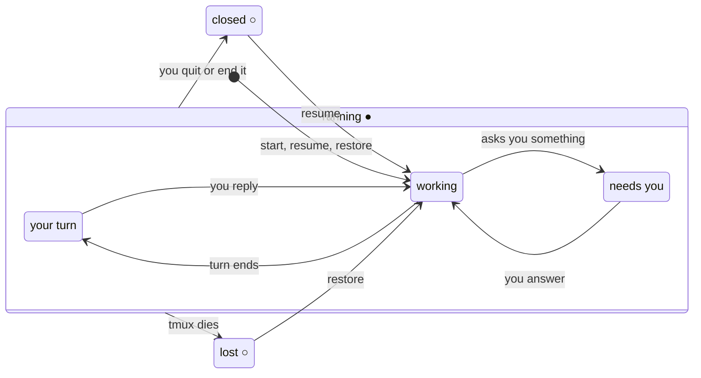

<h1>
  <picture>
    <source media="(prefers-color-scheme: dark)" srcset="assets/logo-dark.png">
    
  </picture>
</h1>

**Start an agent in VS Code, check on it from a terminal, pick it up in Neovim.**

trails runs Claude Code, Codex, Gemini, Copilot, Cursor, opencode or any other
agent CLI in tmux, one window per task, grouped into a session per workspace, so
every editor and terminal sees the same agents. It shows which are working and
which are waiting on you, brings old ones back when you need them, and puts the
editor beside the agent with one key. A cockpit view puts several side by side.


That's all trails does. There's no TUI or GUI of its own: the sessions are tmux,
and once an agent is running trails gets out of the way. Uninstall it and
everything left is ordinary tmux that still makes sense.

Because it's just a command, it plugs into whatever you already use:

- **any editor with a terminal**: VS Code, Zed's agent threads, a Neovim side
  panel, or anything else that can run a command in a pane
- **any terminal** (Ghostty, iTerm, Terminal), in the project you're working on
  or over ssh to the machine where the agents live
- **the macOS menu bar**, which shows the agents waiting on you

Every one of them lands on the same trails.

```console
~/code/checkout $ trails
checkout (acme) ▸ Pick a trail: █   # enter: open · tab: toggle YOLO · ctrl-n: name it · ctrl-e: editor · ctrl-/: preview · ctrl-x: end or forget
▌ ● needs you  claude · yolo  Add idempotency keys to payment retries
  ● your turn  claude    #2   Fix the flaky cart-total test
  ● working    codex          Migrate orders to Postgres 17
  ○ lost       claude         Spike: replay Stripe webhooks
  claude · new trail
  codex · new trail
  cursor · new trail
  ↩ resume old trails  (3 ended)
```

Enter on **↩ resume old trails** opens the conversations that ended here, and Esc
comes back:

```console
Resume a trail: █   # enter: resume · tab: toggle YOLO · ctrl-e: editor · ctrl-/: preview · esc: back
▌ ○ closed     claude · yolo  2d ago  Release notes for v2.3
  ○ closed     claude         4d ago  Tighten the refund window
  ○ closed     codex          6d ago  Bump the payment SDK
```

From `~`, or a fresh ssh login, `trails` lists your workspaces instead, with what
runs in each; from a shell in a workspace's tmux session it lists that workspace's
trails across its codebases. `trails ls -a` shows every directory:

```console
~ $ trails ls -a
@checkout-3         ● needs you  claude · yolo  acme      ~/code/checkout              Add idempotency keys to payment retries
#2 @checkout-7      ● your turn  claude         acme      ~/code/checkout              Fix the flaky cart-total test
                    ● working    codex          acme      ~/code/checkout              Migrate orders to Postgres 17
@storefront-2       ● working    claude         personal  ~/code/storefront            Lazy-load product images
                    ○ lost       claude         acme      ~/code/checkout              Spike: replay Stripe webhooks
                    ○ closed     claude · yolo  acme      ~/code/checkout      2d ago  Release notes for v2.3
```

Because each agent runs inside tmux, it outlives the terminal that started it.
Close the laptop, drop Wi-Fi or quit the terminal, and the conversation is still
running when you come back. ssh in from another machine and run `trails`, and
you're in the very same coding sessions: the same conversations, mid-turn, right
where you left them. One ssh connection reaches every workspace, and you move
between them without reconnecting.

And if tmux itself goes down, after a reboot, a crash or a `kill-server`, the
trails show up as *lost*, not gone. `trails restore` brings each one back on the
conversation it was in, into its workspace.

## Install

With Homebrew, on macOS or Linux:

```console
brew install gunasekar/tap/trails
```

By hand: it's one POSIX `sh` script. Put [`bin/trails`](bin/trails) anywhere on
your `PATH`.

It needs `tmux` (3.3 or later), `fzf` and `jq`, plus at least one agent CLI on
`PATH`. macOS ships `jq`; Homebrew installs all three. Reading recent opencode
conversations uses `sqlite3`, which macOS ships with.

## Quickstart

```console
trails ws add acme ~/code/checkout   # file a codebase under a workspace (optional)
cd ~/code/checkout
trails              # pick an agent to start, or a trail to rejoin or resume
trails edit         # the editor beside it, in the same tmux session
trails ls -a        # where every trail is, in every directory
trails map 4        # the four that most want you, side by side in one window
trails keys         # tmux.conf lines that put all of this on a key
```

With no workspaces configured, everything runs in one workspace called
`default`, and trails behaves much as it did before 1.0.

## Usage

| Command | Does |
|---|---|
| `trails` | the picker for where you are: this codebase's trails and the agents you can start; a workspace's trails, from a shell in its tmux session; or the workspaces, from `~` |
| `trails ws [NAME]` | pick a workspace, or go to `NAME`: switch to its session inside tmux, attach outside, landing on the trail that most wants you; its picker when nothing runs there |
| `trails ws list` / `ws of [DIR]` / `ws add NAME [DIR]` | the workspaces in the config; the one `DIR` (here) belongs to; put `DIR` (here) in workspace `NAME`, creating it if new |
| `trails new NAME [AGENT]` | start a trail named `NAME`, with `-y` for YOLO: its editor view is `<workspace>/NAME`, and claude takes `NAME` as its own name, so other Claude sessions can message it by that name |
| `trails edit` / `shell` | the codebase's editor beside its trail (alone when nothing runs there) as a window in the workspace, or a shell across the bottom of that window: made once, then selected. The window you are on says which codebase, or `DIR` after the command |
| `trails ls [-a \| DIR]` | this directory's trails: running, lost when tmux died, or finished in the last 10 days. `DIR` lists that directory instead, `-a` every directory |
| `trails end KEY` | end a trail from anywhere, by the key `trails ls` prints (`acme/checkout-2`) |
| `trails restore` | bring back every trail lost when tmux died, each on its own conversation, into its workspace, detached |
| `trails map [N]` | several running agents side by side in one window: re-attach to the map already up, pick a set, or take the `N` that most want you (`map new` forces a fresh pick) |
| `trails keys` | print tmux.conf lines that put the picker in a popup and bind the companions; trails binds nothing itself |
| `trails swiftbar` | put the menu-bar plugin into SwiftBar (macOS); `--remove` takes it out |
| `trails config` | open the config in `$EDITOR`, writing the built-ins first if there isn't one |
| `trails help` | the commands and picker keys (also `-h`, `--help`) |

### Workspaces

A workspace is a set of codebases you choose, related or not: one per company,
say, or everything personal. It is declared in `~/.config/trails/config.json`,
as paths or globs, with an optional `root`:

```json
"workspaces": {
  "acme":     { "root": "~/code", "codebases": ["~/code/*"] },
  "personal": ["~/src/*", "~/.dotfiles"]
}
```

- A glob picks up a newly cloned repo with no edit. A directory inside a listed
  repo belongs to the repo, and a git worktree belongs where its main checkout
  does, wherever it lives.
- The most specific entry wins an overlap: an exact path beats a glob.
- `root` is where "＋ another codebase…" in the picker starts browsing; `~`
  without one.
- A name is letters, digits, `-` and `_`: it becomes a tmux session name.
- `trails ws add NAME` edits the file for you, and the picker offers to when you
  start a trail in a directory no workspace claims. Edits never move a running
  trail.

### What tmux shows

A workspace is a tmux session named after it, and each trail is a window in it.
Each trail's window is also linked into a small session of its own, the *editor
view*, which is what an editor attaches to: one trail and nothing it can wander
off to.

```text
acme                    ← workspace
├─ checkout·claude      ← a trail
├─ checkout·claude-2    ← another trail, same codebase
├─ checkout·nvim        ← its editor (trails edit)
└─ ledger·codex
acme/checkout           ← editor view: checkout·claude, linked
acme/checkout-2         ← editor view: checkout·claude-2, linked
acme/ledger             ← editor view: ledger·codex, linked
```

Plain tmux moves you around: the next and previous window keys, `prefix s` or
`choose-tree`, `switch-client`. `tmux a -t acme` is the workspace and
`tmux a -t acme/checkout` is one trail. trails sets nothing on any of it beyond
`@trails_*` options, never touches your tmux.conf, and binds no keys: `trails keys`
prints lines to paste if you want some.

```text
# trails: paste what you want into tmux.conf
bind a display-popup -E -w 80% -h 70% trails
bind W display-popup -E -w 60% -h 50% 'trails ws'
bind e run-shell 'trails edit'
bind S run-shell 'trails shell'
```

A session exists while something runs in it: the first trail creates the
workspace session, and the last one out takes it down. A session named like a
workspace that trails didn't make is refused, never added to.

### The picker

One command, three screens, chosen by where it runs.

**This codebase** (a shell in a repo, or an editor's terminal): its running and
lost trails first, its companions (not in an editor's terminal, which wants
trails only), then one *new trail* row per agent, then
**↩ resume old trails**, which opens a second list of the conversations that
ended here (Esc goes back). The cursor starts on the trail that most wants you.
Picking a running trail from a terminal of your own lands in the workspace with
that window selected; from an editor's terminal it attaches to the trail's
editor view, so the editor sees that one trail.

**This workspace** (a shell in a workspace's tmux session, or a popup over one):
the same, across its codebases, with a codebase column:

```console
acme ▸ Pick a trail: █   # enter: open · tab: toggle YOLO · ctrl-n: name it · ctrl-e: editor · ctrl-/: preview · ctrl-x: end
▌ ● needs you  checkout  claude · yolo  Add idempotency keys to payment retries
  ● your turn  ledger    codex          Migrate orders to Postgres 17
  ○ lost       checkout  claude         Spike: replay Stripe webhooks
  editor       checkout  nvim · acme/checkout
             checkout  · new claude
             checkout  · new codex
             ledger    · new claude
             ledger    · new codex
  ＋ another codebase…  (51 more under ~/code)
  ↩ resume old trails  (12 ended)
```

New-trail rows appear for the codebases with something running, lost or recent;
the rest are behind **＋ another codebase…**, a list of the workspace's
directories that leads to that codebase's screen.

**The workspaces** (from `~`, `/`, or `trails ws`): one row each, with what runs
in it, the one you were in last marked and under the cursor. Enter attaches to
its session on the trail that most wants you, or shows its screen when nothing
runs there. ctrl-n names a new workspace and takes its first codebase from the
directories under `~`.

```console
Pick a workspace: █   # enter: open · ctrl-n: new workspace
▌ acme         ● 3 trails · 1 needs you  · last
  personal     ● 1 trail
  client-x       nothing running
```

Every trail has two signals. The glyph says whether it is running (`●`) or not
(`○`); the word says what's going on:

| State | Means | Enter |
|---|---|---|
| `●` needs you | running, and the agent is asking you something | attach |
| `●` your turn | running, and it finished its turn | attach |
| `●` working | running, and it's busy | attach |
| `○` lost | tmux died under it (a reboot, a crash, `kill-server`) | bring it back on its conversation |
| `○` closed | it ended in the last 10 days; its conversation can be resumed | resume it, in the mode it last ran in |
| `○` elsewhere | its conversation is open in a `claude` that trails didn't start | refuses, and says where it's open |



| Key | Does |
|---|---|
| `enter` | open the row: attach, restore, resume, start the agent, or go to the companion |
| `tab` | toggle YOLO (run everything unconfirmed) on an agent to start or a closed trail, flipping a new trail from the config's `mode` and a closed one from the mode it last ran in |
| `ctrl-n` | name the new trail under the cursor: type the name, then Enter. On the workspace picker, a new workspace |
| `ctrl-e` | the editor for the row's codebase (`trails edit`) |
| `ctrl-/` | show or hide the preview: the trail's screen as it is now. Open by default when the terminal fits two columns |
| `ctrl-x` | end a running trail, close a companion, or forget a lost one |

`trails` refuses to open an agent in `/`. `$HOME` is fine. A directory no
workspace claims is asked about once: add it to a workspace, or run it here this
once, in `default`.

### Named trails

Name a trail when you start it, and that one name is how everything refers to it:

```console
~/code/checkout $ trails new payments
~/code/checkout $ trails ls
@payments        ● working    claude · yolo  acme  ~/code/checkout
#2 @checkout-7   ● your turn  claude         acme  ~/code/checkout  Fix the flaky cart-total test
```

- **tmux** has its window as `checkout·payments` and its editor view as
  `acme/payments`, so `tmux a -t acme/payments` works.
- **The picker and `trails ls`** show `#payments` where an unnamed trail shows `#2`.
- **Claude** runs with `--name payments`, the name its peers use. In another
  Claude session, "ask payments how the retries look" reaches it.

A name is letters, digits, `-` and `_`, not digits alone, and unused by any running
or lost trail. A named Claude shows its name as its title instead of a summary of
what it's doing. Resuming or restoring a named conversation brings its name back.
Unnamed trails work as before, with a name Claude picks for itself.

### Companions

The editor or a shell for one codebase, as a window in the workspace beside that
codebase's trails: `checkout·ide` (the editor beside the trail) or `checkout·nvim`
(the editor alone), with the shell as a pane along its bottom.

| Command | Opens |
|---|---|
| `trails edit` | `$EDITOR` (nvim if unset) beside a live view of the codebase's trail, in one window: the trail you run it from, else the one there that most wants you. Alone in its own window when nothing runs there. `C-b z` zooms the editor's pane |
| `trails shell` | a shell in the codebase, tmux's own default command, as a pane across the bottom of that editor window, a quarter high |

The window you are on decides the codebase: run from a trail or another
companion, the command acts on that codebase; from a plain window, on the pane's
directory; outside tmux, on the current directory, or on `DIR` given after the
command. Run again, it selects the window that is already there; run from the
companion itself, it goes back where you were. The picker lists the editor
windows, and ctrl-e there opens the editor for any row's codebase. Companions
aren't restored: one command reopens them.

### trails ls

Plain `trails ls` lists the directory you're in, the same trails as the picker.
`trails ls ~/code/api` lists that directory, as if you'd run `trails ls` there.
`trails ls -a` lists every directory:

```console
$ trails ls -a
@api-4             ● needs you  claude · yolo  acme      ~/code/api               Rework the retry budget
#2 @dotfiles-9     ● your turn  claude         personal  ~/.dotfiles              Fix the flaky test
                   ○ lost       claude · yolo  acme      ~/code/foundry           Improve observability
                   ○ closed     claude · yolo  personal  ~/notes         2h ago   Weekly review
@scratch-1         ○ elsewhere  claude         personal  ~/scratch       1d ago   Spike on caching  (open in claude, pid 812)

● needs you  running, asking you something
● your turn  running, finished its turn
○ lost       not running: tmux died · trails restore brings it back
○ closed     not running: it ended · resume it from its directory
○ elsewhere  not running here: open in a claude trails did not start
```

The first column names each running trail, so you can call it something:
`#2` marks the second trail in the same codebase, `#name` a named trail, and
`@name` the name a running Claude answers to: the one to give another Claude session
when you want it to reach this one. The workspace column follows the agent. The
dim legend covers the states on screen. Piped, `ls` prints one tab-separated line
per row, in the same order, with `-` for an empty field:

```text
life  state  session  agent  yolo  dir  id  when  pid  peer  workspace  title
```

| Field | Values |
|---|---|
| `life` | `running` (the trail is there) or `stopped` |
| `state` | `needs-you`, `your-turn`, `working` (running) · `lost`, `closed`, `elsewhere` (stopped) |
| `session` | what to attach to: the trail's editor view (`acme/checkout-2`), or a `trails-…` session from before 1.0; `-` for a conversation nothing is running |
| `yolo` | `yolo` or `-` |
| `when` | when an ended conversation was last active (Unix time), else `-` |
| `pid` | the process holding an `elsewhere` one, else `-` |
| `peer` | the name a running or `elsewhere` Claude answers to, for messaging it from another Claude session, else `-` |
| `workspace` | the trail's workspace; for an ended conversation, the one its directory belongs to now; `-` for a session from before 1.0 |

That is what the menu-bar plugin below reads, and anything else can too. The
title stays last, so a reader that takes the last field keeps working as columns
are added. Set `TRAILS_RECENT_MAX=0` for a poll that only wants running trails; it
skips reading conversation history.

### trails map

`trails map 4` puts the four trails that most want you side by side in one
window, across workspaces. Each pane is a live view of a real trail, labelled with
its directory, its agent and what it's working on; type into any of them, and
detach (`C-b d`) to leave them all running. `trails map` re-attaches to the map
already up, or lets you pick a set.

### Menu bar (macOS)

trails ships a [SwiftBar](https://swiftbar.app) plugin that keeps your agents in
the menu bar, whether or not you're looking at them:

```console
brew install --cask swiftbar    # once, then open it and pick a plugin folder
trails swiftbar                 # link the plugin in; --remove takes it out
```

- **The icon is the trails mark.** Its top dot turns red when an agent is asking
  you something and amber when one finished its turn; its bottom dot is green
  while any agent is working. The number beside it is how many want you.
- **The menu** lists every running trail. Each has *Resume*, which opens it in
  a new tab of your terminal, and, once it's your turn, *End session*, which runs
  `trails end`.
- **Open sessions in** at the bottom picks the terminal: Terminal (the default),
  iTerm or Ghostty.
- **Notifications:** an agent that stops working and stays stopped for 30 seconds
  sends one notification. `TRAILS_NOTIFY_AFTER` changes the wait; `0` notifies at
  once.
- It hides itself when no agent is running.

The plugin is linked, not copied, so `brew upgrade trails` updates it along with
the `trails ls -a` it reads.

### Environment

| Variable | Default | Does |
|---|---|---|
| `TRAILS_ATTACH` | *(unset)* | `view` or `workspace`: where picking a trail lands, instead of guessing from the editor's variables (see From an editor) |
| `TRAILS_RECENT_DAYS` | `10` | how far back closed trails are listed |
| `TRAILS_RECENT_MAX` | `5` | how many of them to show (`0` for none) |
| `AGENT_SETTLE` | `0.35` | seconds between the two screen samples that tell *working* from *your turn*, for agents that don't report their own state |
| `AGENT_ASK_RE` | *(see script)* | regex meaning "this agent is asking you something" |

### Agents

Which agents trails can start, and how, is a list in
`~/.config/trails/config.json`, beside the workspaces. With no file, the built-in
agents apply. `trails config` writes them out as a starting point and opens the
file in `$EDITOR`. Changing agents never needs a change to trails.

```json
{
  "mode": "default",
  "default_agent": "claude",
  "agents": [
    {
      "name": "claude",
      "program": "claude",
      "yolo": "--dangerously-skip-permissions",
      "session": { "start": "--session-id {id}", "resume": "--resume {id}", "id": "uuid" }
    },
    { "name": "claude-opus", "program": "claude --model opus", "yolo": "--dangerously-skip-permissions" },
    { "name": "aider", "program": "aider --model ollama_chat/gemma3:1b", "yolo": "--yes-always" }
  ]
}
```

| Field | Means |
|---|---|
| `name` | what the picker shows. Letters, digits, `.`, `_` and `-` |
| `program` | the command line to run, split on spaces (no shell quoting; use a wrapper script for anything fancier) |
| `yolo` | *(optional)* the flag Tab adds to run everything unconfirmed |
| `session` | *(optional)* how trails learns which conversation a trail is in, so it can come back after tmux dies. See below. |
| `default_agent` | *(optional)* listed first in the picker |
| `mode` | *(optional)* `default` (the agent's own, prompting mode) or `yolo`: the mode a *new trail* row starts in. Tab flips a row from it, so with `yolo` Tab is how you start one in default mode. Closed trails come back in the mode they last ran in unless Tab flips them, and an agent with no `yolo` flag always runs in default mode. |

Only agents whose command is on `PATH` are offered. Recent conversations are
read from claude's and opencode's own history, and are filed under the first
agent that runs `claude` or `opencode`.

#### Restore

To bring a trail back after tmux dies, trails needs the ID of the conversation
it was in. `session.resume` says how to resume one (`{id}` marks where the ID
goes), plus one of three ways to learn the ID:

| Key | trails gets the ID by | Example |
|---|---|---|
| `start` | choosing it, and starting the agent under it | `"start": "--session-id {id}", "id": "uuid"` |
| `create` | running a command that prints a fresh one | `"create": "cursor-agent create-chat"` |
| `find` | reading it back from the agent's own files (`claude`, `codex`) | `"find": "codex"` |

`id` is the shape `start` generates: `uuid`, or `ses_hex` for opencode. `find`
also follows a conversation that changes inside the agent, such as `/resume` in
claude.

`session.name` is the flag that gives the agent a name of its own, `{name}` marking
where it goes. Only a named trail passes it. The built-in claude has
`"name": "--name {name}"`, and an agent without it still gets the trails name.

#### Built-in agents

The six most-used coding agents, with flags checked against each tool's latest
`--help` or docs in October 2026:

| Agent | Runs | YOLO flag | Restore |
|---|---|---|---|
| claude | `claude` | `--dangerously-skip-permissions` | yes: chosen ID, and follows `/resume` |
| codex | `codex` | `--dangerously-bypass-approvals-and-sandbox` | yes: read from `~/.codex/sessions`, once its first message is sent |
| gemini | `gemini` | `--approval-mode yolo` | yes: chosen ID |
| copilot | `copilot` | `--allow-all` | yes: chosen ID |
| cursor | `cursor-agent` | `--force` | yes: `cursor-agent create-chat` |
| opencode | `opencode` | `--auto` | yes: chosen ID |

A trail that never got a message has nothing to resume, so restoring one
starts the agent fresh in its place.

Any other agent is one entry in the config. It runs in tmux like the rest; add a
`session` block only if the tool can start or resume by ID:

```json
{ "name": "aider", "program": "aider --model ollama_chat/gemma3:1b", "yolo": "--yes-always" },
{ "name": "antigravity", "program": "agy", "yolo": "--dangerously-skip-permissions" },
{ "name": "qwen", "program": "qwen", "yolo": "--yolo" }
```

trails refuses a YOLO launch as root for the two flags that also bypass a sandbox
(`--dangerously-skip-permissions`, `--dangerously-bypass-approvals-and-sandbox`).

### From an editor

Any editor that can run a command in a terminal pane can run `trails`, and every
editor and every shell shares one set of trails. In an editor's terminal, picking
a trail attaches to its editor view, so the panel shows that one trail; trails
tells an editor's terminal from your own by the variables editors set (`NVIM`,
`ZED_TERM`, `TERM_PROGRAM`), and `TRAILS_ATTACH=view` or `=workspace` settles it
by hand. Inside tmux, an editor's pane becomes a nested client of the view, and a
shell's client is switched to the workspace instead: no agent ever runs bare in
a pane any more, so an agent started from Neovim inside tmux is reachable from
everywhere else too.

- **VS Code:** add a terminal profile, then pick **trails** from the new-terminal
  menu. A login shell, so `trails` is found on your usual `PATH`:

  ```json
  "terminal.integrated.profiles.osx": {
    "trails": { "path": "/bin/zsh", "args": ["-lc", "exec trails"] }
  }
  ```

  To open it as an editor tab with a key, add to `keybindings.json`:

  ```json
  {
    "key": "cmd+alt+t",
    "command": "workbench.action.terminal.newWithProfile",
    "args": { "profileName": "trails", "location": "editor" }
  }
  ```

  The same works in Cursor and other VS Code-based editors.

- **Zed:** in `settings.json`, set `"terminal_init_command": "exec trails"` under
  `agent`. In remote mode it runs on the ssh host, where tmux keeps the agent
  alive across disconnects.
- **Neovim:** open a terminal running `trails` in a side panel, like the first
  demo at the top.
- **Anything else:** run `trails` wherever the editor opens a terminal.

### Upgrading from 0.6

Trails started before 1.0 live in sessions named `trails-<project>`. They keep
working until they end: `trails` and `trails ls` list them, attach to them and end
them as before, and a record of one that died with tmux restores as a window in
the workspace its directory belongs to now. Nothing is moved while it runs. The
state and config files stay where they were; the records of new trails go one
directory down, under their workspace.

The `trails ls` TSV has a new `workspace` field before the title, and `session`
now holds the editor view's name. The menu-bar plugin that ships with this version
reads both.

## How it works

[docs/ARCHITECTURE.md](docs/ARCHITECTURE.md) covers how workspaces, trails and
editor views map onto tmux, how trails are found and named, how *working*, *your
turn* and *needs you* are read from the agent or off the screen, how trails
survive tmux dying, where recent conversations come from, and how the map and the
companions borrow views without owning them. Key design decisions are recorded in
[docs/decisions/](docs/decisions/), and the 1.0 design with its principles in
[docs/design/trails-1.0.md](docs/design/trails-1.0.md).

## License

[MIT](LICENSE)
