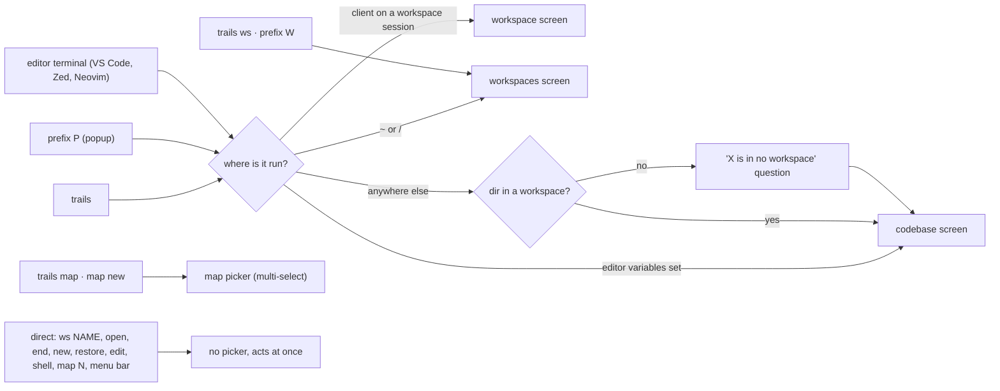
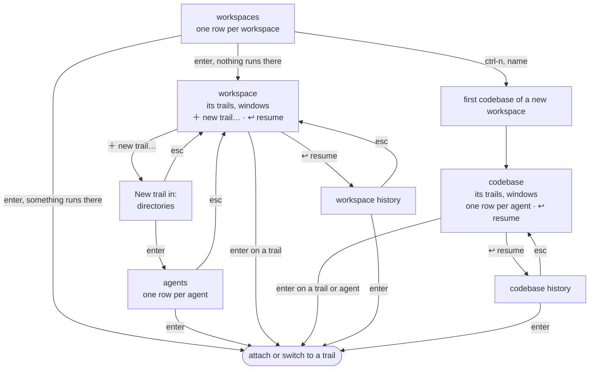
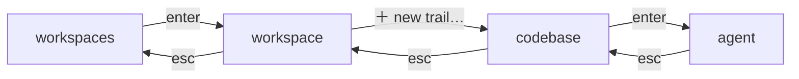
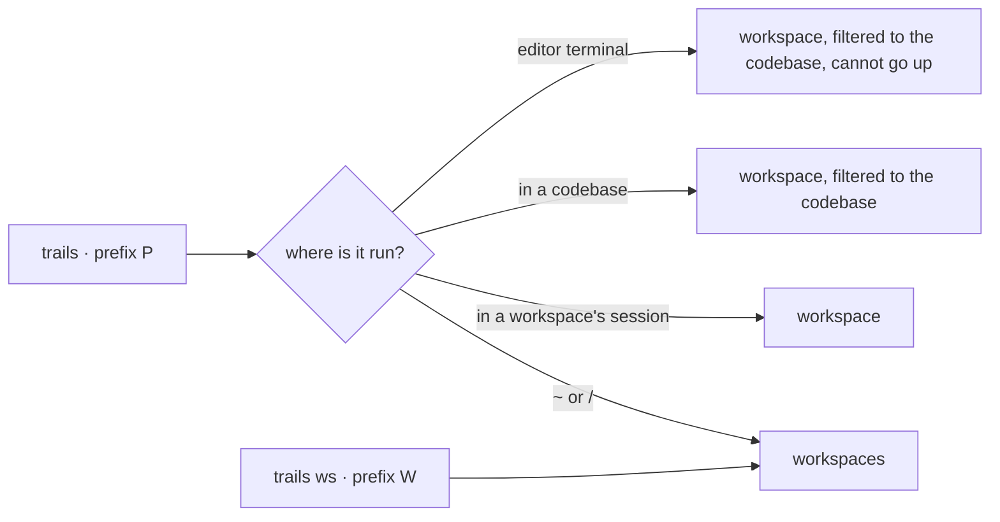
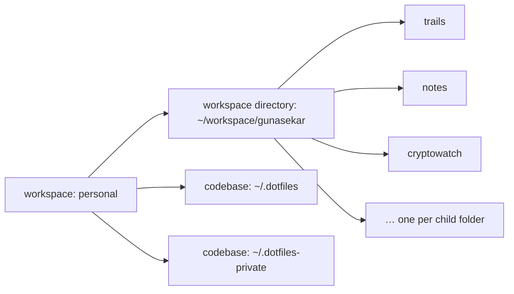
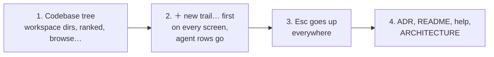

# Picker consolidation: design

Status: proposed · 2026-10-21, updated 2026-10-22. Nothing here is built yet. The open questions at
the end need an answer before any of it is, and what is decided becomes an ADR.

trails has grown several pickers, each added for one way in. Which one you get,
what its rows are and what a key does there depend on where you ran it. This
document draws what exists today, the single model proposed to replace it, and
the path from one to the other.

## Today

### Entry points

Nine ways in. Four of them open a picker, and a bare `trails` chooses between
three different ones by looking at where it runs.



### Screens and how they connect



### What makes it hard to predict

| # | Inconsistency | Where |
|---|---|---|
| I1 | The same command opens three different screens depending on the directory, the editor variables and the tmux session | bare `trails`, `prefix P` |
| I2 | A codebase starts an agent from one row per agent. A workspace goes through `＋ new trail…`, a directory list, then the agents | codebase vs workspace screen |
| I3 | Enter on a workspace attaches when something runs there, and shows its screen when nothing does | workspaces screen |
| I4 | ctrl-n names a trail on the codebase and agent screens, creates a workspace on the workspaces screen, and does nothing on a workspace's screen | every screen |
| I5 | Esc goes back a level on some screens and quits on others. The codebase and workspace screens quit, the agents and history screens go back | every screen |
| I6 | The directory list holds a workspace's codebases plus every folder under its `root`, and `root` defaults to `~`. A workspace without one lists `~/Library`, `~/Movies` and the rest | `＋ new trail…` |
| I7 | `prefix W` and `prefix P` are different pickers with different rules, though both are "where do I go next" | key bindings |

## Proposed

### One picker, four levels

One hierarchy. Every level has the same kinds of rows and every key means the
same thing on every level. Where you run it only decides which level it opens
on.



| Level | Rows | Enter | Esc |
|---|---|---|---|
| workspaces | one per workspace with what runs there | attach to it, on the trail that most wants you. Its level when nothing runs there | quit |
| workspace | `＋ new trail…` first, then its trails and windows with a codebase column, then `↩ resume old trails` | on a trail, go to it. On `＋ new trail…`, choose a codebase | up to workspaces |
| codebase | when reached from `＋ new trail…`, the workspace's codebase tree (see below) | open its agents | up to the workspace |
| agent | one `<agent> · new trail` per agent | start it and go to it | up to the codebase list |

A codebase's own screen has the same shape: `＋ new trail…` first, which goes
straight to the agents, then its trails, then `↩ resume old trails`. The cursor
starts on the trail that most wants you, and on `＋ new trail…` when none does.

`↩ resume old trails` keeps its own list, scoped to the level it was opened
from, and Esc there goes back to that level.

Keys, the same everywhere:

| Key | Does |
|---|---|
| enter | go down a level, or go to the trail under the cursor |
| esc | go up a level, or quit at the top |
| tab | toggle YOLO on an agent or a closed trail |
| ctrl-n | name the trail being started on the agent level. On the workspaces level, a new workspace |
| ctrl-e | the editor for the row's codebase |
| ctrl-/ | the preview |
| ctrl-x | end a running trail, forget a lost one, close a window |

### Where each entry point opens



Running inside a codebase opens the workspace level filtered to that codebase:
the same screen, with fewer rows, where `＋ new trail…` goes straight to that
codebase's agents. Esc first clears the filter, then goes up as usual.

An editor terminal stays the one exception, and a deliberate one. It sees one
codebase and cannot go up, since a panel that wandered into other workspaces
would attach the whole workspace inside the editor.

### What changes for you

| Today | Proposed |
|---|---|
| Three screens for a bare `trails` | One screen at different levels |
| Agent rows straight on a codebase's screen | `＋ new trail…` first, then the agent list, one extra Enter |
| Esc quits most screens | Esc goes up a level, and quits only at the top |
| Directories under `root` (or `~`) listed | The workspace's codebase tree, plus `browse…` |

Kept as they are: Enter on a running workspace attaches at once, and ctrl-n on
the workspaces screen makes a workspace.

## Decided

| # | Question | Decision |
|---|---|---|
| D1 | Enter on a running workspace | Attach at once, as today |
| D2 | Starting an agent | Always through `＋ new trail…`, the first row on a workspace's and a codebase's screen, followed by the running trails, the windows and `↩ resume old trails`. From a codebase it goes straight to the agents |
| D3 | Making a workspace | ctrl-n only, which the workspaces screen's hint already names. A `＋ new workspace…` row can come later if it is missed. Not both: two ways to do one thing is what this document removes |
| D4 | Esc on a codebase's screen | Goes up, to its workspace, then the workspaces, then quits: one rule on every screen. An editor's terminal still quits (question 1 below) |
| D5 | How deep the codebase tree goes | One level: a workspace directory lists its child folders. Deeper is reached by `browse…` (question 2 below) |
| D6 | A folder reached by `browse…` | Inside a workspace directory or codebase it already belongs to the workspace, so nothing is asked or written, and it is listed under its parent while it has trails or recent history. Outside every one, the "is in no workspace" question (D7) |
| D7 | A folder no workspace claims | `default` is the standard home for its trails. The question, asked on a bare `trails` and on `browse…` alike, lists workspaces by name: `default` first, *not added to a workspace*, so Enter keeps it there. Then the workspace browsed from, then the rest in config order, each *add it here*. `trails new` asks nothing and uses `default`, as today |

## Questions, now decided

### 1. Esc on a codebase's screen

This comes up when `trails` runs in a codebase's directory: a shell in
`~/workspace/gunasekar/trails` that is not a workspace's tmux session, or an
editor's terminal there. It opens that codebase's screen.

```console
~/workspace/gunasekar/trails $ trails
trails (personal) ▸ Pick a trail: █   # enter: open · ctrl-e: editor · ctrl-/: preview · esc: up
▌ ＋ new trail…
  ● your turn  claude · yolo  @trails-c6  Trails sessions in specific directory
  ↩ resume old trails  (5 ended)
```

Press Esc. Today the picker quits, back to the shell. Proposed, it goes up to
the workspace that holds the codebase:

```console
personal ▸ Pick a trail: █   # enter: open · ctrl-e: editor · ctrl-/: preview · ctrl-x: end · esc: up
▌ ＋ new trail…
  ● your turn  _dotfiles  claude · yolo  @dotfiles-8e     1 awaiting input · claude agents
  ● your turn  gunasekar  claude · yolo  @gunasekar-57    Google AI conversation access
  ● your turn  trails     claude · yolo  @trails-c6       Trails sessions in specific directory
  ↩ resume old trails  (7 ended)
```

And Esc there goes up to the workspaces, and Esc there quits.

- (a) Esc goes up, *recommended*: one rule on every screen, and the way to
  another codebase is always Esc then `＋ new trail…`, wherever you started.
- (b) Esc quits, as today: from a codebase there is no way to the rest of the
  workspace without leaving and running `trails ws`.

An editor's terminal quits on Esc either way. It sees one codebase by design.

### 2. Workspaces, workspace directories, codebases

This comes up on `＋ new trail…` from a workspace's screen: the list of where the
new trail can start. Today it is everything the workspace's `codebases` match,
plus every folder under its `root`, and a workspace without a `root` uses `~`.
For `personal` that brings in `~/Library`, `~/Movies` and the rest of `~`.

#### The model

A workspace holds *workspace directories*, each a folder whose children are
codebases, and may hold single codebases that live elsewhere. A workspace
directory can itself be a codebase, for an agent working across all of it.



Today's config already says this, so it needs no new keys:

| Config entry | Means |
|---|---|
| a glob ending in `/*`, like `~/workspace/gunasekar/*` | a workspace directory: its child folders are codebases |
| a plain path, like `~/.dotfiles` | a single codebase |
| a plain path that is also a workspace directory, like `~/workspace/gunasekar` | that directory is a codebase too |
| `root` | where `browse…` starts walking. No longer listed by itself |

A workspace with two workspace directories lists both:

```json
"lattiq": { "codebases": ["~/workspace/lattiq/*", "~/workspace/lattiq-infra/*"] }
```

#### The picker

The tree, drawn in fzf. Typing filters on the names as drawn, so `kite` finds
`kitewatch` without opening anything. fzf searches only what it draws, so a
workspace directory's name matches its own row, not its children's. Within a
workspace directory, codebases with trails or recent history come first.

```console
personal ▸ New trail in: █   # enter: pick · esc: back
▌ ~/workspace/gunasekar/            codebase itself
    trails                          ● 1 trail
    notes                           ○ 2 ended
    claude-personal-backup
    cryptowatch
    imprint
    kitewatch
    markview-smart-tables.nvim
    markview.nvim
    studio-web
    trips
  ~/.dotfiles                       ● 1 trail
  ~/.dotfiles-private
  browse…                           from ~
```

`browse…` walks the file system from `root` (or `~`), one folder at a time.
What happens to the folder picked depends on where it is (D6):

- **Inside a workspace directory or a codebase**, like
  `~/workspace/lattiq/apps/backend`: it already belongs to the workspace, by
  the rule that a directory inside a listed one belongs to it (`trails ws of`
  says `lattiq` for it today). Nothing is asked and nothing is written to the
  config. The trail starts there, labelled `backend`. While it has trails or
  recent history, the tree lists it under its parent, so the next one needs no
  browsing:

  ```console
  ▌ ~/workspace/lattiq/
      apps/backend                  ● 1 trail
      augur                         ○ 3 ended
      …
  ```

- **Outside every one**, like `~/Downloads/spike`: the "is in no workspace"
  question (D7). Every row is a workspace. `default` comes first, so Enter starts
  the trail there and adds the folder nowhere. A workspace row adds the folder
  to that workspace as a single codebase, and the workspace you browsed from
  comes right after `default`:

  ```console
  ~/Downloads/spike is in no workspace: █
  ▌ default    not added to a workspace
    personal   add it here
    lattiq     add it here
    prcpnt     add it here
    padnam     add it here
  ```

  A bare `trails` in such a folder asks the same question, in the same order,
  every time it runs there. Today's "run it here this once" row goes: it read
  as if the answer were remembered, and it never was.

A whole new workspace directory, a folder whose children should all be
codebases, is added in the config (`trails config`) as a `/*` entry. `trails ws
add` and the question above add one codebase, never a workspace directory.

- (a) One level: a workspace directory lists its children, and anything deeper
  is reached by `browse…`, *recommended*. Predictable, and a large directory
  like `~/workspace/lattiq` stays one screen of names to filter.
- (b) Every level: the whole tree under each workspace directory. Finds nested
  repos without browsing, but lists every subfolder of every repo.

Nested repos, a monorepo's packages for example, could later be listed by
finding `.git` below a workspace directory, rather than by listing every
folder.

## Path

Each phase ships on its own, with tests, and leaves trails working.



1. **The codebase tree (I6).** D5, D6 and D7. Fixes the `personal`
   list.
2. **`＋ new trail…` first (I2).** On a codebase's screen it replaces the agent
   rows. Decided (D2), so it can go first if preferred.
3. **Esc goes up (I5).** D4.
4. **Record it.** An ADR, and the README, `trails help` and `ARCHITECTURE.md`
   updated to the one model.

I3, I4 and I7 stay as they are by D1 and D3: Enter on a running workspace
attaches, ctrl-n makes a workspace, and `prefix W` is the workspaces screen.
